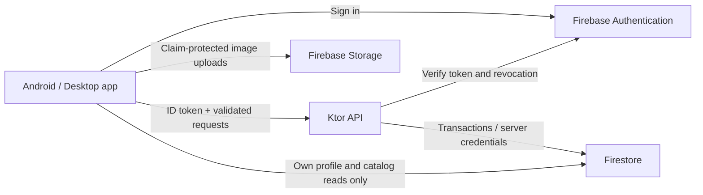

# MZBotanicals backend

A standalone Kotlin/Ktor API using the existing Firebase Authentication and Firestore project. Firebase still handles sign-in. The server verifies ID tokens, makes authorization decisions, validates writes, and calculates prices. The app keeps its realtime Firestore reads and sends profile, cart and catalog writes through this API.

**Payments are disabled.** Quotes and order drafts are not purchases. They do not reserve stock, clear carts, collect payment, calculate tax or shipping, or trigger fulfillment. The checkout endpoint returns `503 payments_unavailable` without writing an order. Do not treat a draft as a paid order.

## Architecture



- Kotlin 2.3.21, Ktor 3.5.2, Java 21, Firebase Admin 9.10.0. The standalone server build leaves the app's existing compiler and framework versions unchanged.
- Application Default Credentials; no private key or admin email is built into the client.
- Every protected request requires a valid Firebase ID token with a verified email. Token verification checks revocation. API administrator requests also require the current server-side user record to retain `admin: true`.
- Strict JSON rejects unknown fields such as `isAdmin`, `customerId`, `totalAmount`, or `status`. The owner comes from the verified token.
- USD amounts use integer cents. Existing catalog `price` values are converted exactly; invalid precision rejects a quote. New catalog writes also maintain the legacy dollar field for existing product displays.
- Product changes require a revision (`If-Match`), and write an audit record in the same transaction. Catalog deletion does not remove existing draft snapshots.
- Draft creation reads catalog prices and writes the snapshot atomically. Idempotency is scoped to the authenticated UID and request payload. Replays return the same draft; a different payload or expired draft returns `409`. Drafts expire after 24 hours.
- JSON bodies are limited to 64 KiB, carts to 50 distinct products and 1–10 units per product, and product lists to 100 entries per page.
- Per-instance throttling: 600 requests/minute per direct peer, 120 per authenticated user, and 10 draft creations/minute per user. Client-supplied forwarded headers are not trusted. Put a shared limiter/WAF at the edge before scaling instances; these counters are not distributed.
- Exact browser-origin allowlist, no credential cookies, no redirect-following in the app API client, generic failures and request IDs. Logs do not include authorization headers, request bodies, or exception messages.
- Firestore client writes are denied, including for claimed admins. The API uses the Admin SDK, which bypasses rules, so the runtime service account's IAM permissions and API checks are both required.
- Product images permit only claimed, email-verified admins, JPEG/PNG/WebP MIME types and 5 MiB maximum. MIME metadata is not malware scanning. Store no private customer files under `images/`. Firebase download-token URLs are shareable.

## Run and test

From the repository root, with Java 21:

```sh
./gradlew -p server test installDist
```

On Windows use `gradlew.bat`. The server can build without an Android SDK. Integration tests are skipped unless loopback Firebase emulators are explicitly configured.

Run the Firebase rule tests and actual Firestore transaction tests together (Node 22+ and Java 21):

```sh
cd security-tests
npm ci --ignore-scripts
npm test
```

These tests use only the `demo-mzbotanicals` emulator project. They do not require credentials or contact your live database. The emulator test runner supplies `APP_ENV`, the demo project and both emulator endpoints. Production refuses emulator environment variables. Emulator mode refuses non-demo projects or non-loopback endpoints.

To run the server locally against emulators, start Firebase with `firebase emulators:start --project demo-mzbotanicals --only auth,firestore,storage`, then set:

```text
APP_ENV=emulator
FIREBASE_PROJECT_ID=demo-mzbotanicals
FIREBASE_AUTH_EMULATOR_HOST=127.0.0.1:9099
FIRESTORE_EMULATOR_HOST=127.0.0.1:8085
```

Run `./gradlew -p server run`. Emulator mode binds only to loopback and still verifies tokens using the Firebase emulator; it has no anonymous or fixed-token bypass. The app build requires an HTTPS backend origin; use an HTTPS development endpoint for native-device integration.

## API

All `/v1` endpoints except `/capabilities` require `Authorization: Bearer <Firebase ID token>`. Sign in using Firebase's existing client SDK; never send a password to this API. Users must verify their email. An admin role is a custom claim, not a customer profile field.

| Method / path | Purpose |
| --- | --- |
| `GET /health/live` | Process health |
| `GET /health/ready` | Firestore connectivity |
| `GET /v1/capabilities` | Payments and inventory reservations are disabled |
| `GET /v1/me` | Current customer's profile |
| `PUT /v1/me` | Replace allowed profile fields; identity/email come from token |
| `GET /v1/products?limit=25&after=<id>` | Bounded product page and next cursor |
| `GET /v1/products/{id}` | Product, with revision in `ETag` |
| `PUT /v1/admin/products/{id}` | Admin create/update; `If-Match: "0"` to create or migrate an unversioned legacy product |
| `DELETE /v1/admin/products/{id}` | Admin delete; current `If-Match` required |
| `GET /v1/cart` | Current customer's cart |
| `PUT /v1/cart` | Replace cart with validated products and quantities |
| `POST /v1/quotes` | Read current catalog prices and calculate subtotal |
| `POST /v1/order-drafts` | Create/replay a draft; `Idempotency-Key` required |
| `GET /v1/order-drafts/{id}` | Owner or admin only; other users receive 404 |
| `POST /v1/checkout` | Always 503 until a real payment integration is implemented |

Cart, quote and draft body:

```json
{"items":[{"productId":"shirt-001","quantity":2}]}
```

The draft key must be 16–128 letters/digits/underscores/hyphens, for example a UUID. Reuse the key after timeouts; use a new key only for a new intent. Empty carts are accepted only by `PUT /cart`. Client-selected pack-size/price overrides are not accepted; each sellable variant should be a separate catalog product.

Product input:

```json
{
  "title":"Botanical T-shirt",
  "description":"Cotton shirt",
  "priceMinor":2500,
  "thumbnail":"https://example.com/shirt.png",
  "category":"Merchandise",
  "strains":[],
  "amountOfSeeds":null,
  "isPopular":false,
  "isNew":true,
  "isDiscounted":false
}
```

Profile input: required `firstName`, `lastName`; optional `address`, `city`, `state`, `postalCode` and `phoneNumber` strings. Postal codes remain strings to preserve leading zeros. Optional fields omitted during `PUT /me` are cleared. No payment details, identity documents or new date-of-birth collection are implemented.

Errors are `{ "code": "...", "message": "...", "requestId": "..." }`. Keep the request ID for support. Do not log bearer tokens or profile bodies.

## Staging and production rollout

No cloud project, database rules, roles or live app have been changed by adding this code. Use a staging Firebase project for the first deployment and account checks.

1. Configure `FIREBASE_PROJECT_ID` and `APP_ENV=production` on the host; `PORT` defaults to 8080. Set `ALLOWED_ORIGINS` only for the exact HTTPS web frontends that should call the service. Native apps do not need CORS entries.
2. Attach a dedicated service identity using Application Default Credentials. Grant only the Firestore data access and Firebase Auth user-read permissions the runtime needs. Keep custom-claim management in a separate trusted operator identity; do not give the runtime project-owner or Firebase Auth admin privileges.
3. Terminate TLS at the hosting ingress, redirect HTTP, apply HTTPS-only ingress/HSTS, request timeouts and shared rate limits. Keep the service's direct HTTP port private. Cloud Run is compatible with the included container; nothing is auto-deployed.
4. Build the image from the root: `docker build -f server/Dockerfile -t mzbotanicals-backend .`. The runtime uses a non-root user. Container construction still needs verification on a Docker-enabled machine.
5. Use trusted operator credentials to assign admin privileges by Firebase UID: `./gradlew -p server adminClaims --args='<uid> grant'`. Use `remove` to remove the role. The command preserves unrelated claims and revokes refresh tokens; the user must sign in again. It never grants privileges based on an email constant. Storage rules evaluate token claims; already-issued tokens can retain their claims until expiry, whereas the API also checks the current user record.
6. Build the updated app with `MZ_BACKEND_URL=https://your-backend-host` or `-PmzBackendUrl=https://your-backend-host`. Missing configuration gives an explicit service-unavailable message; there is no fallback to direct database writes. Do not distribute this build before its backend is reachable.
7. Back up the current Firestore/Storage rules and export data. Verify profiles, existing catalog prices, image URLs and legacy carts in staging. Old duplicate product entries in carts may require resetting that customer's cart through the API. Existing `isAdmin` profile fields are ignored.
8. Release the updated app and apply `firebase deploy --only firestore:rules,firestore:indexes,storage --project <staging-or-approved-project>` in a coordinated maintenance window. These rules intentionally block writes from old app versions. Plan a minimum-client-version rollout; do not relax rules to allow forged orders.
9. Confirm customer A cannot access customer B's profile or draft, customer writes to the catalog fail, claimed admins can manage products, and checkout stays disabled. Monitor failures and Firestore usage, then configure backups/restore drills, alerting and retention for customer data and draft/audit records.

Rollback: keep checkout closed. Revert to the prior application/backend release only with reviewed compatible rules. A blind rollback to unrestricted rules would reopen the bypass. No automatic data migration or live deletion is included.

Before enabling payments, implement the approved provider's server integration, signed/replay-protected webhooks, payment reconciliation, tax/shipping calculation, stock reservations with expiry, refund handling, and the client's eligibility/shipping policies. A browser redirect or client success screen must never mark an order paid.

## References

- [Firebase token verification](https://firebase.google.com/docs/auth/admin/verify-id-tokens)
- [Firebase custom claims](https://firebase.google.com/docs/auth/admin/custom-claims)
- [Firestore transactions](https://firebase.google.com/docs/firestore/manage-data/transactions)
- [Firestore security and Admin SDK/IAM boundaries](https://firebase.google.com/docs/firestore/security/overview)
- [OWASP authorization guidance](https://cheatsheetseries.owasp.org/cheatsheets/Authorization_Cheat_Sheet.html)

These controls and tests are a development baseline, not a security certification or a substitute for a review of the deployed environment.
